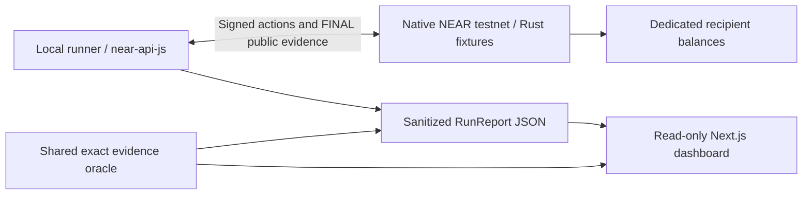

# NEAR Replay Lab

Trace native NEAR payment intent through finalized receipts and recipient balances.

Developers giving payment authority to AI integrations need to know whether execution still matches the exact approval after a recipient substitution, a lost response, or concurrent requests. Generic authorization, allowlists and amount caps can leave that obligation unchecked. NEAR Replay Lab turns those failures into repeatable, inspectable native NEAR testnet comparisons.

The demo's memorable result: an approved **0.001 NEAR** obligation credits **0.002 NEAR** in the deliberately unsafe fixture and **0.001 NEAR** in the guarded fixture. A local TypeScript runner captures public chain evidence; a read-only Next.js dashboard recalculates and displays each verdict. Two constructed Rust vaults provide contrasting recipient binding and once-only settlement behavior. This is a bounded experiment, not a measured vendor vulnerability or live-model evaluation.

The build is verified with **three accepted actual testnet comparisons among ten trials**. Each established the five-case matrix: both fixtures held legitimate and expired controls; the unsafe fixture settled substituted and duplicate payments; the guarded fixture enforced the captured recipient and once-only invariants. Dashboard and clean-reproduction checks passed. The [submission package](docs/submission/README.md) is prepared. This public source snapshot exports reviewed local commit `d78d68f8bd5b4375677c2e0fd870bc4a32059df3`. The demo post and final hackathon application remain outstanding. [Publication provenance](PUBLICATION.md) records the source archive. See [Project State](docs/project-state.md) and the [verification record](docs/verification.md).

Watch the [narrated recorded-demo video](docs/submission/demo/near-replay-lab-demo.mp4), or follow the credential-free walkthrough below. The video uses actual saved dashboard screenshots and authored summary cards, with explicit recorded-testnet provenance. [Timed script](docs/submission/demo-script.md) and [media verification](docs/submission/media-verification.md) accompany it. A hosted demo URL is not available yet.

## Features and architecture

- Five constructed cases: legitimate payment, expired approval, recipient substitution, discarded response with a fresh duplicate, and independent-key concurrency.
- Exact obligation binding and an atomic `Pending` claim in the guarded Rust fixture.
- Local official-SDK signing with retained transaction hashes, bounded FINAL observation and checkpointed public evidence.
- Exact integer receipt/balance comparison with `HOLDS`, `VIOLATED` and `INCONCLUSIVE` verdicts.
- Read-only import, scenario comparison, public receipt inspection and JSON export; no browser signing authority.
- Bundled Wasm, disposable testnet bootstrap/setup, offline report validation and documented reproduction.



NEAR's restricted function-call keys, asynchronous receipts and native transfers are the execution mechanism under test. The guarded contract's claim/callback state machine matters because one invoice can receive new requests even when an earlier transaction hash is unique. Signing keys stay in the local runner. [Detailed architecture](docs/architecture.md) explains the data flow and trust limits.

## Open the recorded demo

Use Node.js 24 and npm. The checked environment is Node **24.19.0** with npm **11.17.0**. Run these commands from the repository root:

```sh
npm ci
npm run build:runner
npm run cli -- inspect examples/recorded-runs/core-suite.json
npm run cli -- validate examples/recorded-runs/core-suite.json
npm run cli -- verify examples/recorded-runs/core-suite.json guarded
npm run dev
```

Open the URL printed by Next.js, normally [http://localhost:3000](http://localhost:3000), and select **Load recorded demo**. You can also import `examples/recorded-runs/core-suite.json` directly. Select each scenario to inspect the unsafe/guarded verdicts, exact credits, approval/state evidence and FINAL receipts. Viewing this saved evidence requires no signing key, wallet connection, testnet funds, or Rust installation. The browser keeps imported files in tab memory.

The example and same-origin demo file, `apps/web/public/reports/recorded-suite.json`, contain the same sanitized first full-suite report. Two additional accepted captures are saved as `examples/recorded-runs/core-suite-repeat-2.json` and `examples/recorded-runs/core-suite-repeat-3.json`. These are three accepted captures among ten actual trials; seven other trials were unsuccessful and retain their original evidence. The [acceptance evidence](docs/acceptance-evidence.json) and [trial summary](docs/trial-summary.json) record the full result.

| Recorded comparison | Value |
| --- | --- |
| Run ID | `e73b251b-95a1-4699-a761-8a0e3ef50981` |
| Capture time | `2026-11-02T10:42:26.876Z` |
| Network/RPC | Native NEAR testnet, `https://test.rpc.fastnear.com` |
| Capture build | `0.1.0 (19aa9e2)` |
| Coverage | Five cases, two deployed fixtures, ten target results |
| Controls | Legitimate and expired controls `HOLDS` on both fixtures |
| Fault cases | Unsafe `VIOLATED`; guarded `HOLDS` for all three |
| Offline checks | `validate`: 0; strict guarded verification: 0; strict unsafe verification: 2, as expected |


| Accepted capture | Run ID | Capture time |
| --- | --- | --- |
| [core-suite.json](examples/recorded-runs/core-suite.json), trial 4 | `e73b251b-95a1-4699-a761-8a0e3ef50981` | `2026-11-02T10:42:26.876Z` |
| [core-suite-repeat-2.json](examples/recorded-runs/core-suite-repeat-2.json), trial 6 | `13bb5a1d-023e-417e-84d1-774d94b05e19` | `2026-11-02T11:08:47.746Z` |
| [core-suite-repeat-3.json](examples/recorded-runs/core-suite-repeat-3.json), trial 10 | `9e5057ff-ae10-4f24-8d5a-5d37aac0e08b` | `2026-11-02T11:27:24.164Z` |

All use the same capture source, `19aa9e234d7b27605585588a1aa3ee3e748fb069`, and export build `0.1.0 (19aa9e2)`. Each passed fresh report/oracle validation with comparison and guarded exits 0, expected unsafe exit 2, 24 FINAL attempts and zero unresolved attempts. Together they use 30 distinct invoice obligations and 72 distinct transaction hashes. The public exports preserve the live capture evidence, changing only provenance/build metadata.

The repeats can be checked offline with no signing key:

```sh
npm run cli -- validate examples/recorded-runs/core-suite-repeat-2.json
npm run cli -- verify examples/recorded-runs/core-suite-repeat-2.json guarded
npm run cli -- validate examples/recorded-runs/core-suite-repeat-3.json
npm run cli -- verify examples/recorded-runs/core-suite-repeat-3.json guarded
```

To inspect the demonstrated unsafe violations offline:

```sh
npm run cli -- verify examples/recorded-runs/core-suite.json unsafe
```

Its exit code is **2**, because strict verification requires every selected invariant to hold. The comparison run itself exited **0** because it established the expected full matrix below. Reports have explicit `recorded` provenance and retain real deployed-contract execution, public signatures, complete finalized receipts, views and balance changes. Approvals, proposed actions and response-loss injection are deliberately constructed. No live language model was evaluated.

### Earlier direct-transfer capture

`examples/recorded-runs/first-transfer.json` remains a separate actual direct-transfer example; it can also be imported in the dashboard.

| Recorded direct evidence | Value |
| --- | --- |
| Capture time | `2026-11-02T07:10:09.845Z` |
| Network | Native NEAR testnet |
| Capture build | `0.1.0 (9016111)` |
| Approved and observed credit | `1000000000000000000000` yoctoNEAR, exactly 0.001 NEAR |
| Recipient balance | 10 NEAR → 10.001 NEAR |
| Finalized balance blocks | `275866090` → `275866129` |
| Direct-transfer verdict | `HOLDS`: exactly one intended credit is proven |

The transaction is [jvvNi5mMZHsiLUJtf93PuSPWXykFGtSyams6oYA15oi](https://testnet.nearblocks.io/txns/jvvNi5mMZHsiLUJtf93PuSPWXykFGtSyams6oYA15oi). The JSON preserves successful FINAL transaction and receipt outcomes, public signer identity, and finalized before/after balance evidence. This is a saved capture with explicit `recorded` provenance. It is not a continuously running feed.

## Capture a new direct transfer

For a manually configured direct transfer, prepare two fresh, isolated, funded named `.testnet` accounts: a disposable signer and a distinct recipient. Retain the signer's disposable ed25519 private key locally. Account funding and gas use native testnet NEAR; no paid API or mainnet account is required. The automated fixture path below uses `bootstrap` to create fresh local operator configuration through the free testnet helper.

In a fresh checkout without a `.env` file, copy the example using your shell:

```powershell
Copy-Item -LiteralPath .env.example -Destination .env
```

```sh
cp .env.example .env
```

Edit `.env` in a local editor. Replace the account and private-key placeholders with the disposable account values. Do not place a private key in a command argument, report, screenshot, browser, or commit.

| Variable | Required value or default |
| --- | --- |
| `NEAR_TESTNET_ACCOUNT_ID` | Funded disposable named `.testnet` signer |
| `NEAR_TESTNET_PRIVATE_KEY` | That signer's local ed25519 private key |
| `NEAR_TESTNET_RECIPIENT_ID` | Distinct isolated named `.testnet` recipient |
| `NEAR_RPC_URL` | `https://test.rpc.fastnear.com`, the free FastNEAR testnet endpoint |
| `NEAR_AMOUNT_YOCTO` | `1000000000000000000000`, exactly 0.001 NEAR |
| `NEAR_REPORT_PATH` | `reports/local/legitimate-transfer.json` in the example |

Then run:

```sh
npm ci
npm run build:runner
npm run cli -- help
npm run cli -- transfer
npm run cli -- inspect reports/local/legitimate-transfer.json
npm run cli -- validate reports/local/legitimate-transfer.json
```

The npm CLI script loads `.env` with Node's `--env-file-if-exists` support. Signing stays in the local Node runner. The runner retains the signed transaction hash before broadcasting, observes that hash through `FINAL`, and checkpoints sanitized public evidence even when a run cannot establish settlement. `.env`, `.local/`, and `reports/local/` are ignored local paths; secret setup manifests must stay in `.local/`.

`transfer` exits **0** only for `HOLDS`, **2** for `VIOLATED` or `INCONCLUSIVE`, and **1** for a command/configuration error. `inspect` and `validate` make no RPC calls and exit 0 when the report shape and recalculated verdicts are valid; a valid report can still describe a violation or inconclusive run. Import the resulting JSON in the dashboard to inspect the same evidence.

Keep the recipient dedicated to the run. Unrelated transfers, incomplete receipts, missing balances, nonce failures, or an unresolved transport outcome cannot establish a successful intended payment. All monetary JSON values are exact decimal integer strings: 1 NEAR is `1000000000000000000000000` yoctoNEAR.

## Fixture comparison checkpoint

The constructed contracts share `pay(invoice_id, recipient, amount_yocto)`, worker authorization, a recipient allowlist, a per-payment amount cap, and expiry checks. The unsafe fixture omits exact obligation binding and the once-only claim gate. The guarded fixture binds the exact recipient and amount, claims `Pending` before scheduling a transfer, and records `Paid` only after a matching private successful callback. A proven transfer failure permits `Failed`; an unknown callback outcome stays locked in `Pending`.

All three accepted actual full-suite captures established this matrix:

| Case | Unsafe fixture | Guarded fixture |
| --- | --- | --- |
| Legitimate control | `HOLDS`: one exact approved credit | `HOLDS`: one exact approved credit |
| Expired control | `HOLDS`: expiry rejection, zero credit | `HOLDS`: expiry rejection, zero credit |
| Recipient substitution | `VIOLATED`: alternate recipient credited | `HOLDS`: recipient mismatch rejected, zero credit |
| Lost-response retry | `VIOLATED`: two distinct successful credits | `HOLDS`: one credit, duplicate rejected |
| Concurrent duplicate | `VIOLATED`: two distinct successful credits | `HOLDS`: one credit, duplicate rejected |

### Create disposable fixtures and run the suite

In a fresh checkout without an existing `.env`, run these commands from the repository root:

```sh
npm ci
npm run build:runner
node dist/packages/runner/src/cli.js setup --check
npm run cli -- bootstrap
npm run cli -- setup
```

The direct Node `setup --check` invocation validates both bundled Wasm files and funding requirements without loading `.env`, reading operator credentials, or making RPC calls. `bootstrap` saves new `.env` and ignored `.local/bootstrap.json` files before calling the free testnet helper; it refuses an existing `.env` and retains generated credentials if the helper outcome cannot be verified. With an already prepared disposable operator `.env`, continue with `setup` instead of bootstrapping again.

Setup requires a disposable operator's full-access ed25519 key and about 4.04 testnet NEAR across two fixtures and four keyless recipients, plus gas. It needs no direct-transfer recipient. The artifacts are validated before account/funding actions or generated fixture-key writes. Rerunning setup reuses persisted keys and reconciles accounts, code hashes, configuration, and permissions; a changed Wasm hash requires separate fresh setup. The secret manifest stays in ignored `.local/testnet-setup.json`.

The default RPC is the free FastNEAR testnet endpoint listed in [NEAR's provider documentation](https://docs.near.org/api/rpc/providers); the legacy official endpoint returned a deprecation error during verification. The worker default is a **2 NEAR gas allowance**, without an additional funding transfer. A 100 Tgas payment is priced against the greater of finalized block gas price and the protocol minimum purchase price; the former 0.05 NEAR allowance was insufficient under protocol 88. Setup and suite preflights use that floor and a fee buffer. See the [suite guide](docs/suite.md) for exact defaults, reserve arithmetic and reconciliation behavior.


Free RPC providers have practical limits. FastNEAR rate limits, dRPC free-plan timeouts on fresh FINAL status and an Intear transport failure left some trials incomplete. Hash-only follow-up through Intear later observed the dRPC approval as FINAL without replaying it; the original failed capture was retained unchanged. `NEAR_RPC_URL` can select another public HTTPS testnet provider from the provider documentation. Review each new report independently; changing a provider does not resolve an unknown obligation or authorize a retry. The [trial summary](docs/trial-summary.json) discloses unsuccessful trials 1, 2, 3, 5, 7, 8 and 9.

Choose the suite report path explicitly, then run and validate the comparison. PowerShell:

```powershell
$env:NEAR_REPORT_PATH = 'reports/local/fixture-suite.json'
npm run cli -- suite
npm run cli -- validate reports/local/fixture-suite.json
npm run cli -- verify reports/local/fixture-suite.json guarded
```

Linux/WSL shell:

```sh
NEAR_REPORT_PATH=reports/local/fixture-suite.json npm run cli -- suite
npm run cli -- validate reports/local/fixture-suite.json
npm run cli -- verify reports/local/fixture-suite.json guarded
```

Import `reports/local/fixture-suite.json` in the dashboard to inspect your captured result. The suite uses fixed 0.001 NEAR payments, fresh invoice IDs, dedicated recipients, and two independent worker keys per fixture. Infrastructure errors or incomplete evidence remain `INCONCLUSIVE`; a new run's result must be assessed independently of the recorded demo.

Plain `suite` exits 0 only when both legitimate/expired controls are `HOLDS`, all three unsafe fault cases are `VIOLATED`, and all three guarded fault cases are `HOLDS`. A valid comparison report intentionally contains unsafe violations.

To select strict target verification for a new run's exit code, substitute `npm run cli -- suite --target guarded` or `npm run cli -- suite --target unsafe` for the plain suite command. Both variants still capture both fixtures. `verify <report.json> [unsafe|guarded]` is an offline check and exits 2 if any selected verdict is `VIOLATED` or `INCONCLUSIVE`; verifying the unsafe target should therefore exit 2 when the constructed weaknesses are demonstrated. `inspect` and `validate` check valid shape and freshly derived verdicts without requiring all targets to hold.

The repository includes `res/unsafe_vault.wasm` and `res/guarded_vault.wasm`; a fresh suite can deploy these artifacts without compiling Rust. Rebuilding is needed when changing fixtures or checking the build locally; the recorded viewer and direct transfer do not use them. A worker's function-call allowance limits gas spending by that key. It is **not a spending cap on the vault's NEAR**.

## Build and check locally

The Node checks and dashboard build run on Windows, Linux, or WSL with Node 24.

The controller's latest core check recorded **197/197 passing Node tests**, passing typecheck, and a passing production dashboard build. Earlier Rust checks passed **74 contract-method tests** against the SDK host; contract sources are unchanged. These checks establish bounded local behavior. Actual settlement evidence comes from the separately captured testnet suite. A fresh checkout of snapshot `a053ce9` without `.env` or `.local/` passed `npm ci`, runner compilation, bundled Wasm preflight, strict guarded report verification and the production web build; its dependency audit reported zero known advisories. The full recorded suite passed visible scenario/approval/FINAL-evidence checks at desktop and mobile widths, and JSON download/import preserved the report exactly. See the [verification record](docs/verification.md) for detailed evidence and [demo screenshot](docs/demo-comparison.jpg).

```sh
npm ci
npm test
npm run typecheck
npm run test --workspace apps/web
npm run typecheck --workspace apps/web
npm run build:web
npm run start --workspace apps/web
```

For Rust checks and Wasm rebuilds, use Rust **1.97.1**, `wasm32-unknown-unknown`, Cargo, `cargo-near` **0.22.0**, a native C/C++ toolchain, OpenSSL development headers, and Binaryen's `wasm-opt`. The SDK minimum Rust version is 1.95. Windows users can perform these steps in an Ubuntu WSL environment; the checked Windows host used WSL for contract builds and tests.

For a new Ubuntu/Linux/WSL build environment:

```sh
sudo apt-get update
sudo apt-get install -y build-essential pkg-config libssl-dev clang cmake binaryen curl ca-certificates
curl --proto '=https' --tlsv1.2 -sSf https://sh.rustup.rs | sh -s -- -y --default-toolchain 1.97.1
. "$HOME/.cargo/env"
rustup toolchain install 1.97.1
rustup target add wasm32-unknown-unknown --toolchain 1.97.1
cargo +1.97.1 install cargo-near --version 0.22.0 --locked
```

Then, from the repository root in that environment:

```sh
cargo +1.97.1 test --locked
cargo +1.97.1 fmt --all -- --check
cargo +1.97.1 near build non-reproducible-wasm --locked --no-abi --manifest-path contracts/unsafe-vault/Cargo.toml --out-dir "$PWD/res"
cargo +1.97.1 near build non-reproducible-wasm --locked --no-abi --manifest-path contracts/guarded-vault/Cargo.toml --out-dir "$PWD/res"
```

The build mode is explicitly `non-reproducible-wasm`; lockfiles pin dependency resolution, but this is not a claim of bit-identical builds across toolchains and operating systems. The commands compile and optimize fixtures without deploying them or accessing signing credentials. See [contract build details](docs/contract-build.md) for the checked host commands and fixture behavior.

## Evidence, construction, and limits

The approvals and fault cases are deliberately constructed inputs. Unit tests use explicitly synthetic public RPC fixtures and the Rust SDK's mocked host. Those tests establish local logic. The full-suite report captures actual testnet contracts, signatures, receipts, state views and recipient credit; the earlier direct transfer captures an operator-configured payment without a fixture contract. Neither evaluates a live agent model.

The oracle requires exact amounts, linked successful FINAL receipts, transaction/action identity, finalized balance references, and matching recipient credit. Contract scenarios additionally require finalized approval/state evidence and a successful legitimate control. Inclusion or top-level function-call success alone cannot prove settlement. `HOLDS`, `VIOLATED`, and `INCONCLUSIVE` apply to the named invariant and captured evidence.

Reports retain complete public RPC outcomes, transaction hashes, account IDs, signer public keys, and public signatures. Private keys and signed transaction bytes are excluded. Import validation recalculates verdicts and rejects secret-bearing or malformed reports. Provenance is a declared label, not cryptographic authentication of the capture, RPC operator, or account isolation.

Both vaults are disposable experiment fixtures. The guarded state machine is bounded by tested invariants and does not provide a production or comprehensive safety guarantee. A permanently unknown callback can leave an obligation locked; there is no automatic recovery procedure. Testnet infrastructure or incomplete observations can yield `INCONCLUSIVE`.

Live-model behavior, external adoption, and external user or maintainer feedback have not been validated. Public deployment, publication, outreach and hackathon submission have not been performed. The [final checklist](docs/submission/final-checklist.md) records the remaining publication and human form inputs. [Architecture](docs/architecture.md), [RunReport format](docs/report-format.md), [fixture interface](docs/fixture-interface.md), and [dashboard behavior](docs/dashboard.md) describe the implementation boundaries.

## Roadmap and team

The next technical priorities after the hackathon are adapter support for a developer's own payment contract, CI-friendly repeatable suites, and independent RPC corroboration. A recovery procedure for permanently unknown callbacks needs a separate design and validation effort. Developer interviews and integration feedback should test whether this workflow reduces debugging effort before claiming adoption or impact. These are proposed next steps, not implemented features.

Solo builder: [@mosesfawole](https://github.com/mosesfawole), with OpenAI Codex assistance under human direction. Built for **NEAR HACKATHON**, proposed **AI Security & Defense** track. This repository's initial project commit is `a36eeda`, dated 2 November 2026; its recorded source history falls inside the organizer's announcement-to-deadline window beginning 19 October. Project code was created for this entry using the dependencies credited below. No older own project or template baseline has been identified in this workspace; disclose one if later introduced. No second project has been declared in this entry.

## Dependencies, AI assistance, and license

Direct versions are pinned: **near-api-js 7.4.0**, **near-sdk 5.30.0**, **TypeScript 5.9.3**, **Next.js 16.4.3**, **React/ReactDOM 19.2.3**, and **Tailwind 4.1.18**. `package-lock.json` and `Cargo.lock` record the transitive resolutions. Next.js was updated from the planning pin after dependency advisory checks; an audit result describes known advisories at that time, rather than proving security.

The project was developed with human direction and **OpenAI Codex assistance** for implementation, tests, documentation, review and submission media. Runtime payment requests are deterministically constructed; the runner does not call a live language model or paid AI API. AI assistance and review do not certify the fixtures or their dependencies. The demo uses genuine browser screenshots, authored Pillow summary cards, FFmpeg encoding and offline Windows `System.Speech` narration with Microsoft Hazel Desktop; the voice is synthetic and no voice was cloned. These media tools are outside the application runtime.

Original project code is provided under the [MIT license](LICENSE), copyright © 2026 NEAR Replay Lab contributors. Credit to the [NEAR JavaScript SDK](https://github.com/near/near-api-js), [NEAR Rust SDK](https://github.com/near/near-sdk-rs), and the Node.js, Rust, TypeScript, Next.js, React, and Tailwind projects. Dependencies retain their upstream licenses.
