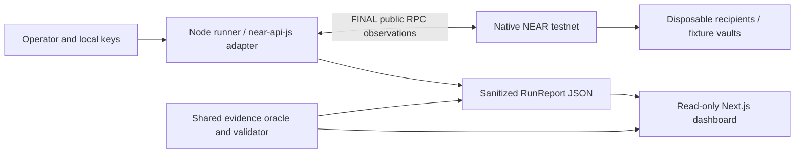

# Architecture and evidence boundaries

NEAR Replay Lab separates local transaction authority from public evidence and its read-only presentation. The recorded demonstration contains an actual five-case comparison against both deployed testnet fixtures. Legitimate and expired controls hold on both; recipient substitution and duplicate settlement violate the unsafe fixture's invariants while the guarded fixture holds. The earlier direct transfer remains a separate example.

Keys are available only to the local runner. The dashboard reads public reports and has no signing, wallet, or private-key dependency. A saved capture can be reviewed without Rust, credentials, or an active testnet run.

## Components

| Component | Responsibility |
| --- | --- |
| `packages/core` | Browser-safe report types, exact integer evidence arithmetic, derived verdicts, and runtime validation |
| `packages/near-adapter` | Official SDK signing/provider integration, bounded public RPC requests, finalized balance/view queries, retained transaction identities, and sanitized observations |
| `packages/runner` | Local configuration, disposable bootstrap/setup, artifact preflight, direct-transfer and five-case suite execution, report checkpoints, and offline inspection/verification |
| `contracts/unsafe-vault` | Constructed authorized payment target with generic checks and deliberate obligation-binding/once-only omissions |
| `contracts/guarded-vault` | Constructed exact-obligation target with atomic Pending claim and private callback state transitions |
| `apps/web` | Import validation, provenance labels, exact balances, verdicts, receipt timelines, public raw evidence, and JSON export |
| `examples/recorded-runs` | Sanitized actual fixture comparisons, the earlier direct transfer, and an explicit allowance-failure capture |
| `res` | Built Wasm artifacts for the two fixtures |

The shared core is the authority for monetary verdicts. The viewer neither infers settlement from a green execution status nor trusts a stored verdict without recalculating it. Unsupported report versions and invalid imports are rejected; an import error preserves the previously loaded valid report.

## Local setup and command boundaries

`bootstrap` saves fresh disposable operator configuration in new `.env` and ignored `.local/bootstrap.json` files before calling the free testnet helper. It refuses an existing `.env` and retains credentials for an unverified helper outcome. A direct Node `setup --check` invocation validates bundled Wasm exports and funding requirements without loading `.env`, reading operator credentials, or making RPC calls. `setup` validates those artifacts before deploying/funding fixtures and persisting generated fixture/worker keys in ignored `.local/testnet-setup.json`.

The setup manifest is persisted as `pending` before management actions and becomes `ready` after reconciliation. Rerunning setup reuses identities and reconciles already-created accounts, deployed hashes, configuration, and restricted-key permissions. A changed Wasm hash requires a separate fresh manifest. Defaults reserve about 4.04 testnet NEAR across fixtures and keyless recipients, plus gas. See the [suite guide](suite.md) for exact funding/configuration defaults and setup recovery boundaries.

`suite` captures both fixtures for all five cases. Its comparison exit code requires legitimate/expired controls to hold, the three unsafe fault cases to violate their invariants, and the three guarded cases to hold. `suite --target unsafe|guarded` still captures both fixtures and instead applies a strict selected-target exit policy. Offline `verify <report.json> [unsafe|guarded]` applies that policy to validated saved evidence: any selected violation or inconclusive verdict exits 2. `inspect` and `validate` check shape and recalculated verdicts without rejecting a valid report merely because an unsafe target violates an invariant.

## Transaction and evidence flow

1. Validate native testnet configuration and exact decimal yoctoNEAR values before network side effects. Verify the RPC network before signing.
2. Query dedicated recipient balances at finality. Fixture cases also need canonical approval/configuration views and isolated recipients for each target.
3. Serialize signing per key, query its access-key nonce, and compute the signed hash locally before broadcast. Retain public action and signing metadata without signed bytes or private keys.
4. Broadcast once, then observe the retained hash and signer through `FINAL`. Fixture function-call observations use the SDK's full-receipt `EXPERIMENTAL_tx_status` method with `tx_status` fallback. A bare FINAL result without receipt bodies remains incomplete. Status-method fallback does not create or rebroadcast a replacement transaction.
5. Preserve complete public RPC envelopes, including failed requests and errors. Query transaction/receipt blocks by hash and collect finalized after balances that cover every execution block.
6. Derive a target verdict from linked outcomes, exact approval details, and recipient credit. Contract scenarios also bind finalized state views to their RPC responses and check a successful legitimate control before attributing protection to a rejection.
7. Write a sanitized versioned report. The CLI inspector and browser validate the same shape and derived verdicts before displaying it.

The direct oracle verifies that transaction identity and action details match the approved payment, that every linked `SuccessReceiptId` is present and terminates successfully, and that finalized receipt-derived credit equals the recipient's exact balance delta. Missing/cyclic links, nonfinal evidence, mismatched raw observations, an unsafe nonce representation, unrelated balance changes, or unresolved transport errors remain `INCONCLUSIVE`.

An identical signed transaction observed more than once counts once. The constructed retry experiment instead issues a fresh nonce and a fresh signed request for the same obligation; its once-only property is also tested by simultaneous requests from independent keys. A nonce rejection is an infrastructure result, rather than proof of a protected payment invariant.

## Canonical obligation and worker authority

Each fixture has one disposable owner, authorized worker public keys, a recipient allowlist, and a per-payment amount cap. Restricted function-call keys live on the owner account and can call only the assigned fixture's `pay` method with no attached deposit. Independent workers have independent nonces. The function-call allowance covers key gas spending; the vault's funded native NEAR is a separate balance.

The owner records a canonical obligation with invoice ID, recipient, exact amount, and nanosecond expiry. Both fixtures enforce authorization, approval existence/expiry, a permitted recipient, positive amount, and the generic amount cap. The unsafe fixture intentionally accepts permitted request details that differ from the canonical obligation and allows another request after a previous claim or payment.

The guarded fixture requires the exact canonical recipient and amount. Before constructing the native transfer and private callback it stores `Pending` with a new attempt ID. Only `Approved`, or a previous proven `Failed`, can claim a new attempt before expiry.

| Guarded state | Meaning and next allowed transition |
| --- | --- |
| `Approved` | Canonical obligation exists; an exact authorized request before expiry can claim `Pending` |
| `Pending` | Transfer has been claimed; concurrent or retry requests are rejected |
| `Paid` | A matching private callback received a successful raw transfer result; another settlement request is rejected |
| `Failed` | A matching private callback received a proven failed transfer result; a fresh exact request before expiry may claim `Pending` |

The callback reads the raw `PromiseResult`; callers cannot provide a success flag. It must match the current Pending attempt and canonical transfer detail. Missing, inconsistent, or panicking callbacks leave `Pending` locked. Callback arrival after expiry can finish a claim that was valid before expiry. There is no automatic unlock or recovery process. On-chain `Paid` alone is insufficient evidence of recipient credit: the report must independently retain finalized receipt and balance evidence.

See [fixture interface](fixture-interface.md) and [contract behavior/build](contract-build.md) for JSON method details, fixed bounds, and deliberately unsafe behavior.

## Real execution and constructed inputs

| Layer | Evidence status |
| --- | --- |
| First recorded direct transfer | Actual native testnet execution with finalized public receipts and recipient balances |
| Direct-transfer approval | Operator configuration describing the requested payment; not an on-chain approval or model decision |
| Vault approvals and agent actions | Deliberately constructed experiment inputs |
| Lost response and concurrent duplicate requests | Controlled fault/action construction; successful or failed settlement still requires actual chain evidence |
| TypeScript public RPC fixtures | Explicitly synthetic unit-test data |
| Rust host tests | Real contract methods in the SDK's mocked host, with scheduled actions and raw callback results |
| Recorded fixture comparisons | Actual deployed native testnet execution, finalized receipts, approval/configuration views and isolated recipient balances; complete matrices checked offline |

No runtime live-model call is needed. OpenAI Codex assisted development and review; that assistance is distinct from the constructed actions being evaluated. The experiment does not evaluate a language model's tendency to choose an action.

## Trust and limits

Amounts and nonces use exact base-10 integer strings at JSON boundaries and integer arithmetic for evidence. Recipient isolation, chain/RPC availability, and complete observation coverage are operational assumptions. A report's `live`, `recorded`, or `synthetic` provenance label is declared metadata; validation does not authenticate its creator or RPC operator.

The public JSON contains transaction hashes, account IDs, public keys/signatures, raw outcomes, and finalized block references. Secret-bearing fields and known private-key values are excluded during sanitization/validation. Local `.env`, `.local/` manifests, and `reports/local/` files are ignored. Reports remain public evidence, rather than a channel for transferring credentials.

`HOLDS` establishes only the tested invariant for the recorded evidence. Constructed unsafe behavior is not a vendor vulnerability, and the guarded fixture is not a production-safe recommendation. Unknown evidence remains `INCONCLUSIVE`; unknown transfer state stays locked. External feedback, adoption, live-model performance, and comprehensive safety have not been validated.
